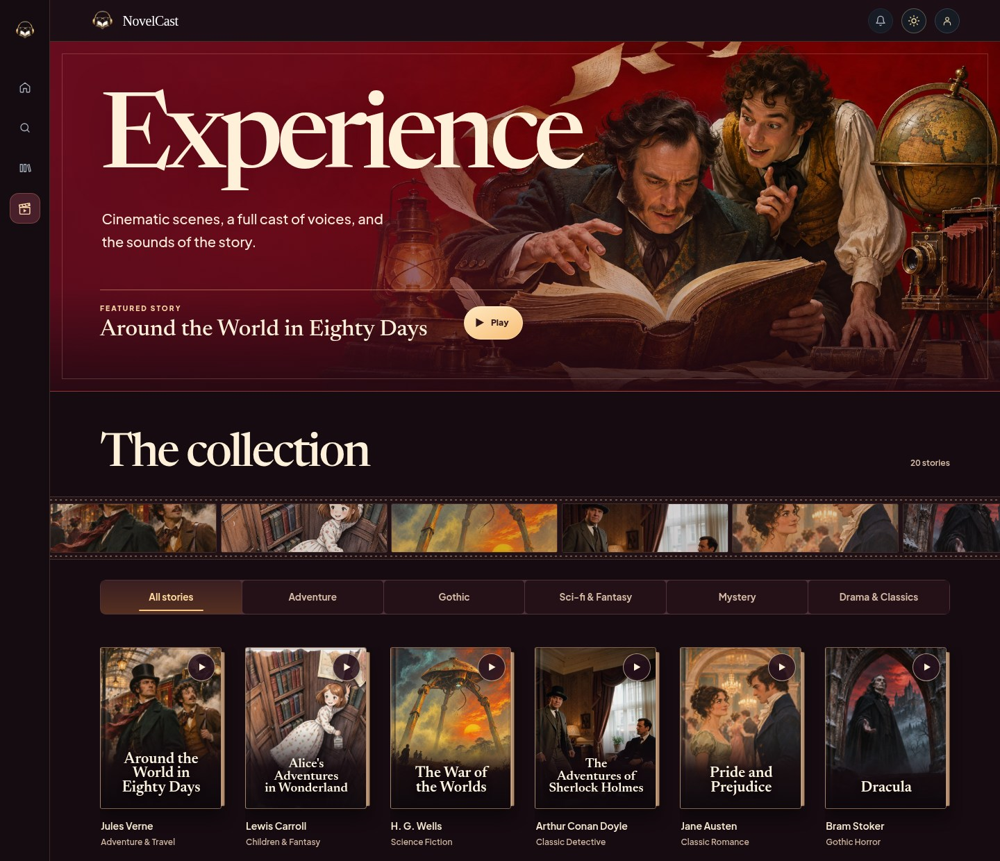
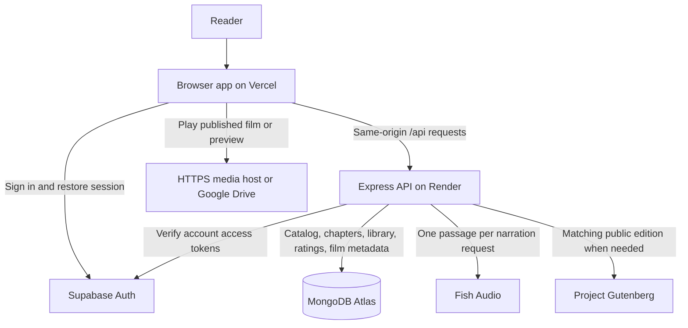

# 🎧 NovelCast — Audiobook & E-Book Platform

**NovelCast** is a web app for discovering public-domain books, reading them online, listening to chapter narration, and watching film adaptations where available. The browser app uses a Node.js and Express API backed by MongoDB Atlas.

[Open NovelCast](https://novelcast.vercel.app/) · [Browse Experience](https://novelcast.vercel.app/#/experience) · [Deployment guide](docs/deployment.md)

[](https://novelcast.vercel.app/#/experience)

---

## ✨ Features

- **Editorial Landing Page (`#/landing`)** — hero with a continuous 3D perspective "book parade" (isometric 3D books built with pure CSS transforms, interactive tilt, sheen, and ambient ASCII background)
- **Audiobook & E-Book Discovery (`#/home`)** — main application dashboard for browsing curated shelves and genre spotlights
- **Book Detail Pages (`#/book`)** — ratings, trending ranks, author & narrator info, chapter counts, reviews, and reading launchpad
- **My Library & Manuscript Uploads (`#/library`)** — personal collection with drag-and-drop file upload zone (EPUB, PDF, TXT, MD) and reading progress tracking
- **Bespoke Reader (`#/reader`)** — dual modes: Classic Book double-page spread and distraction-free Continuous Scroll PDF layout with real-time reading pace (WPM)
- **Sanctuary Access (`#/login`)** — luxury editorial authentication modal with Supabase email verification
- **Listen Now** — Fish Audio narration of the original chapter text, using only `s2.1-pro-free`. A library voice matched to the book's title, synopsis, and subjects is saved in Atlas and reused for every passage and future session. Plays one short passage while preparing only the next; pause, close, and book switching cancel pending work.
- **Experience (`#/experience`)** — browse illustrated book covers in a cinematic shelf with a moving filmstrip and genre filters. Where a film or preview is available, open it in the player. Films with chapter markers also support chapter navigation. [Experience architecture](docs/experience-architecture.md)

## How it works



1. **Browse and read.** The JavaScript app switches views using hash routes. It fetches book details and chapter text separately so browsing does not load an entire book. The API checks Atlas first and can fall back to the bundled catalog or a matching Project Gutenberg edition. [Catalog routes](backend/src/routes/catalogRoutes.js)
2. **Sign in and sync.** Supabase handles email verification and sessions. The API verifies the access token before saving ratings or reading and updating a private library. The browser retains pending library edits locally, then merges and retries if a newer revision already exists on the server. [Library sync](frontend/js/librarySync.js)
3. **Listen.** The audio player sends one passage and its book ID to the API. The server resolves the book’s saved narrator voice and streams MP3 from Fish Audio. The player prepares one passage ahead. [Narration route](backend/src/routes/ttsRoutes.js)
4. **Watch.** The Experience shelf uses the catalog for its covers and genre filters. When you choose a title, the player requests its published film metadata. It opens a Google Drive preview or an HTTPS video, with captions and chapter controls where supported. Titles without a published film show an awaiting-release message. [Film player](frontend/js/filmPlayer.js)

## 🛠️ Tech Stack

| Layer | Technology |
|---|---|
| Architecture | Single Page Application (SPA Hash Router) |
| Structure | HTML5 / JavaScript (Vanilla ES6+) |
| Styling | Tailwind CSS (CDN & compiled utility tokens) |
| API & storage | Node.js, Express, MongoDB Atlas |
| Authentication | Supabase Auth |
| Narration | Fish Audio |
| Hosting | Vercel frontend, Render backend |
| Fonts | Google Fonts — Cormorant Garamond, Bodoni Moda, Playfair Display, Plus Jakarta Sans, Cinzel |
| Icons | Material Symbols |
| 3D & Visuals | CSS 3D transforms (`perspective`, `preserve-3d`), React Bits Canvas PixelCard, ASCII stream |

## 📁 Project Structure

```
NovalCast-Web_DEV/
├── index.html           # Root entry redirect (routes to frontend/index.html)
├── frontend/            # Unified SPA Web Application
│   ├── index.html       # Main application shell & Tailwind design system
│   ├── assets/          # Static media & official vector branding
│   ├── css/             # Custom styles (site.css, landing.css, pixel-card.css, reader.css)
│   └── js/              # Modular application logic
│       ├── views/       # View controllers, including the Experience shelf
│       ├── components/  # Canvas PixelCard component
│       ├── auth.js      # Supabase authentication service
│       ├── data.js      # Catalog dataset & book normalizer
│       └── router.js    # Client-side hash router
├── backend/             # Catalog, library, ratings, narration, and film APIs
├── docs/                # Deployment and feature documentation
├── Referance/           # High-fidelity Figma ASTs & Google Stitch reference screens
├── scripts/             # Build and asset extraction tooling
├── tests/               # Node.js and Playwright tests
└── package.json         # NPM scripts and dev dependencies
```

## 🚀 Getting Started

1. **Clone the repository**
   ```bash
   git clone https://github.com/lukan-lawslaf/NovalCast-Web_DEV.git
   cd NovalCast-Web_DEV
   ```

2. **Run locally**

   Install the root and backend dependencies with `npm ci` and
   `npm --prefix backend ci`. Configure the local environment as described in
   [backend/README.md](backend/README.md), including `Fish_Audio` (or
   `FISH_AUDIO_API_KEY`) for narration. Keep that key on the server.

   Start the frontend and backend in separate terminals:
   ```bash
   # Terminal 1: frontend
   npm run dev

   # Terminal 2: backend API
   npm --prefix backend run dev
   ```
   Then visit `http://127.0.0.1:3000`. The API defaults to port 4000.
   Run `npm run test:audio` for isolated narration API and playback tests;
   these tests use fake provider responses and do not generate real speech.

> **Note:** The application uses client-side hash routing (`#/landing`, `#/home`, `#/book`, `#/reader`, `#/library`, `#/login`, `#/search`, `#/experience`).

## API endpoints

Append the paths below to `https://novelcast.vercel.app` in production or `http://localhost:4000` locally. Vercel forwards `/api` requests to Render. The first production request can take longer while Render wakes. [Deployment guide](docs/deployment.md)

| Method and path | Purpose | Access |
| --- | --- | --- |
| `GET /api/health` | Check API and Atlas readiness. Returns `503` when Atlas is disconnected. | Public |
| `GET /api/books` | List books with `search`, `genre`, `page`, `limit`, and `sort` (`popular`, `newest`, or `title`). | Public |
| `GET /api/books/:id` | Get book metadata and its table of contents. | Public |
| `GET /api/books/:id/chapters/:chapterNum` | Get chapter text and previous/next chapter numbers. | Public |
| `GET /api/ratings` | Get community rating averages and vote counts for catalog cards. | Public |
| `GET /api/books/:id/ratings` | Get a book’s rating summary. A verified session also returns the reader’s vote. | Public, optional session |
| `PUT /api/books/:id/ratings` | Create or update the reader’s vote with a `score` from 1 to 5. | Verified session |
| `GET /api/me/library` | Fetch the signed-in reader’s private library and its current revision. | Verified session |
| `PUT /api/me/library` | Save the library document. A stale revision returns `409` with the current document for merging. | Verified session |
| `POST /api/tts` | Stream an `audio/mpeg` narration response for `{ bookId, text }`. Each passage supports up to 1,200 characters. | Public, requires server-side Fish Audio configuration |
| `GET /api/films` | Read the film mode flag (`filmsOnly`). | Public |
| `GET /api/films/:bookId` | Get a published film’s playback metadata. Returns `404` for an unpublished title. | Public |
| `GET /api/ingest/curated` | Inspect the curated import list and whether an import is running. | Public |
| `POST /api/ingest` | Import one title by Gutendex ID or search. | Operator only |
| `POST /api/ingest/curated` | Import the curated list or a selected subset. | Operator only |

Send verified-session requests with `Authorization: Bearer <Supabase access token>`. The ingestion write routes require a separate operator token and are disabled until `INGEST_ADMIN_TOKEN` is configured. The film router can also serve `GET /api/films/:bookId/:revision/video` and `GET /api/films/:bookId/:revision/captions` when configured with a local film directory. Production playback uses the media URLs returned by the metadata route. [Backend setup](backend/README.md)

```bash
curl 'https://novelcast.vercel.app/api/health'
curl 'https://novelcast.vercel.app/api/books?search=dracula&limit=5'
curl 'https://novelcast.vercel.app/api/books/dracula/chapters/1'
```

## 🗺️ Roadmap

### Available today

- [x] Browse and search the public-domain catalog from MongoDB Atlas, with book details and an interactive 3D landing shelf.
- [x] Read in Classic Book or Continuous Scroll mode with chapter navigation, reading progress, and pace estimates.
- [x] Sign in with Supabase to sync saved books, reading plans, and manuscript metadata. Export a library snapshot as JSON.
- [x] Rate books with a verified account and see community scores.
- [x] Listen to on-demand chapter narration with Fish Audio and a saved narrator voice for each book.
- [x] Browse the illustrated Experience shelf by genre and play films or previews for available titles. Jump between chapters when a film provides chapter markers.

### Upcoming work

- [ ] Save reader notes and highlights so they can be reopened in later sessions.
- [ ] Refine the reader layout and controls on mobile screens.
- [ ] Extract and index text from private manuscript uploads so they can be opened in the reader.
- [ ] Prototype on-demand Experience scenes using public-domain passages. Measure scene preparation time and provider quotas before expanding playback. [Experience proposal](docs/experience-architecture.md)

## 👥 Team

| Member | Role |
|---|---|
| [Ujwal Tyagi](https://github.com/) | Web Development |
| [Nakul Falswal](https://github.com/) | Web Development |
| [Tejasvi N Sharma](https://github.com/Tejasvi-N-Sharma-) | Web Development |
| [Vaibhav Saini](https://github.com/) | Web Development |
| [Tarun Yadav](https://github.com/) | Web Development |

## 🤝 Contributing

This is a team coursework project. To contribute:

1. Fork / clone the repo
2. Create a branch (`git checkout -b feature/your-feature`)
3. Commit your changes (`git commit -m "Add your feature"`)
4. Push and open a Pull Request

## 📄 License

For educational purposes. All book content shown (titles, excerpts, cover concepts) belongs to its respective authors and publishers and is used here as placeholder demo material only.

---

<p align="center"><em>Built with 📚 + ❤️ by Team NovelCast</em></p>
