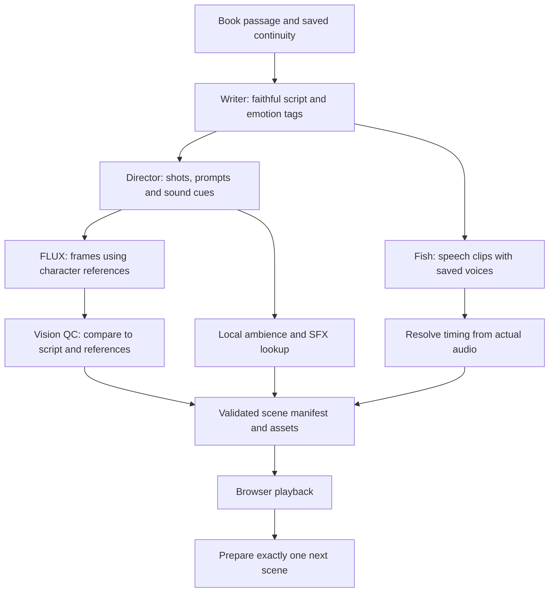

# Experience the Book: architecture and provider proposal

Prepared 28 October 2026. Planning only: no Experience routes, provider integrations, live generations, or application changes have been made for this proposal. Provider availability and quotas must be checked again before implementation.

## Product decisions

- A dedicated cinematic section, separate from Read and Listen: illustrated scenes with camera movement, transitions, subtitles, character dialogue, and sound.
- Faithful dramatization: retain plot, character intent, and original dialogue; condense narration without inventing events or revealing later events.
- Target scenes of 30–45 seconds, ending at natural story boundaries.
- Generate only the first scene during a reusable opening promo, then only the next scene while the current scene plays. Never prepare the whole novel.
- Keep the existing vanilla JavaScript, CSS/Canvas, Node.js/Express, Atlas, and Supabase Auth architecture. No framework migration or Python tooling.

## Recommended providers to benchmark

These are prototype defaults, subject to quality and timing measurements, rather than claims that every account has working access.

| Role | Proposed default | Reason and limit |
| --- | --- | --- |
| Scriptwriter | Gemini `gemini-3.8-flash` | Stronger writing candidate than the lightweight director. The published standard tier includes free input/output; actual project access remains unverified. |
| Stage director and visual QC | Gemini `gemini-3.5-flash-lite` | Image understanding and structured output suit shot planning and checking generated frames. Separate requests and prompts for directing and checking. |
| Visuals | Cloudflare `@cf/black-forest-labs/flux-2-klein-4b` | Supports reference images, allowing reusable character and style references. Benchmark one generated frame per scene first; enable a second frame where the story and budget justify it. |
| Speech | Fish Audio `s2.1-pro-free` exclusively | Preserve the free-model constraint and saved narrator voice. Add saved character voice references for Experience dialogue. |
| SFX and ambience | Curated CC0/local sound assets and Web Audio synthesis | Reusable ambience and effects avoid another per-scene network generation dependency. |
| Assembly and playback | Browser Canvas/CSS plus Web Audio | Play a timed scene manifest with its assets; avoid encoding an MP4 before each scene can start. |

Google lists both selected Gemini models with free standard-tier tokens. Flash-Lite accepts images and supports structured output. Free-tier content may be used to improve Google's products; project quotas and actual capacity vary. Start benchmarking with public-domain catalog passages, and make provider data use explicit before processing private manuscripts. [Gemini pricing](https://ai.google.dev/gemini-api/docs/pricing), [Flash-Lite capabilities](https://ai.google.dev/gemini-api/docs/models/gemini-3.5-flash-lite), [Gemini limits](https://ai.google.dev/gemini-api/docs/rate-limits).

Cloudflare documents fixed four-step inference and up to four reference-image inputs for Klein 4B. Reusing approved references should reduce visual drift; it does not guarantee identical faces or costumes. [Cloudflare Klein launch and reference support](https://developers.cloudflare.com/changelog/post/2026-01-15-flux-2-klein-4b-workers-ai/).

Fish's free model has fair-use limits and no guaranteed time to first audio. Explicitly send `s2.1-pro-free` on every request: an absent or unrecognized model header can select a paid model. Speaker references must also be explicit. [Fish model overview](https://docs.fish.audio/developer-guide/models-pricing/models-overview), [Fish TTS API](https://docs.fish.audio/api-reference/endpoint/openapi-v1/text-to-speech).

### Alternatives and deferred integrations

- **Groq `openai/gpt-oss-120b`:** alternative text writer to evaluate if Gemini writing or account throughput is unsuitable. This is an open-weight model, not a promise of flagship-model quality. Its published free base limits include 30 requests/minute, 1,000/day, 8,000 tokens/minute, and 200,000/day, shared at organization level. Context and token limits can bind before request count. [Groq limits](https://console.groq.com/docs/rate-limits).
- **Qwen3.8-Omni-Flash:** an optional director/QC adapter, not the default for a permanently free design. Alibaba lists usage prices; free allowances depend on the exact model, account, region, and expiry. The realtime variant's documented trial is one million tokens for 90 days in Singapore. [Alibaba model pricing](https://www.alibabacloud.com/help/en/model-studio/model-pricing), [realtime allowance](https://www.alibabacloud.com/help/en/model-studio/qwen3-8-omni-flash-realtime).
- **FLUX.1 Schnell:** useful as a low-cost text-only comparison. Do not silently switch reference-based character scenes to it; changing image models requires a new consistency check.
- **ElevenLabs SFX:** optional for generating reusable special effects later. Its documented SFX calls consume credits and generate at most 30 seconds per call, with looping available. It is unnecessary for the first runtime pipeline. [ElevenLabs SFX](https://elevenlabs.io/docs/overview/capabilities/sound-effects).
- **Use the reader's ChatGPT plan:** retain a future writer-provider interface. OpenAI documents plan usage for eligible open-source/local applications; paid or remotely hosted apps must request access. NovelCast's hosted launch must not depend on unconfirmed access. This capability also does not supply the image and audio generation stages. Keep existing NovelCast authentication separate. [OpenAI plan usage](https://developers.openai.com/siwc/token-sharing-open-source), [preview limits](https://developers.openai.com/siwc/token-sharing-open-source/preview-limitations).
- **Existing custom model-service settings:** assess later against the same quality, access, data-handling, and timing criteria. A configured variable name does not prove a working service or free quota.

No automatic paid fallback for any stage. Exhausted quotas produce an honest waiting/unavailable state.

## Scene generation flow



1. Load a bounded passage from the next unread position, plus a small prior-context summary and saved cast/style information. Select a contiguous source range; do not repeatedly send the whole book.
2. Ask the writer for a compact script with utterance IDs, source references, speaker identities, and emotional intent. Validate it before starting dependent work.
3. Start speech as soon as that script is valid. Run the director concurrently; the director supplies visual prompts, camera choices, and sound cues anchored to utterance IDs.
4. Generate frames and resolve sound assets in parallel. QC compares frames against the planned action, setting, and saved character references. Permit at most one image regeneration per scene, within the remaining time and quota budget.
5. Measure returned audio durations, resolve cue positions, and publish a complete manifest. The browser downloads/decodes assets before reporting the scene ready.
6. During playback, prepare the next scene. Scene N+2 cannot begin until N+1 is actually playing.

QC is a fallible check for visible mismatches, not proof of perfect fidelity. A failed mandatory visual check produces a retry/buffering state, not an unrelated image disguised as a successful scene. Missing optional SFX can use an appropriate existing ambience track.

## Timing, dialogue, and sound

For the first version, synthesize short **utterance-level clips** rather than relying on invented word timestamps. A scene may contain a few narrator/dialogue clips, all belonging to the same one-scene preparation job. Use a bounded concurrency limit shared with ordinary Listen playback; do not launch one request per word.

- Keep dialogue text and spoken metadata separate. Only verified delivery cues reach TTS.
- Save a narrator and a character-to-voice map; never choose a new random voice for each clip. Resolve new characters once from an approved voice catalog, then persist the choice. The model selects a catalog entry, not an invented provider ID.
- Use sparse emotional cues for delivery. Exact additional pauses between clips belong to the playback timeline, not a promise that a generated pause tag lasts an exact number of milliseconds.
- Cue sounds and shots at an utterance's start/end or an explicit offset from that anchor. Subtitles initially follow utterances. Word-synchronized captions or a sound exactly on a particular spoken word require a separately measured alignment capability.
- Decode audio and use its duration to schedule the sequence. Use the Web Audio clock as the master for speech, effects, captions, and animation. Browser animation timers must not become independent clocks.
- Duck ambience under dialogue; crossfade compatible ambient loops; keep SFX restrained and avoid abrupt level jumps.
- Account for audio-device start permission: the user's Experience click activates audio. If activation or decoding fails, show a playable/retry state rather than claiming playback started.

At an assumed 140 words/minute, 30–45 seconds accommodates roughly 70–105 spoken words **before pauses**. This is a planning estimate. Preserve natural boundaries and plot fidelity; never truncate spoken audio to hit a timer. If actual duration lands outside the target, record it and improve segmentation for subsequent scenes rather than silently discarding dialogue.

The existing Fish service accepts a single saved speaker and at most 1,200 text characters per request. Experience needs a server-internal path for its validated clip/cast data; the current browser endpoint is not already a multi-character scene API.

## Throughput and the opening promo

Approximate steady-state critical path, with speech and direction running concurrently:

```text
Tready = Tsource + Tscript
       + max(Tspeech, Tdirector + max(Timages + TQC_and_bounded_retry, Tsound_lookup))
       + Tmanifest + Tasset_download_and_decode
```

Initial startup also includes any uncached cast/style/reference setup. Queue waits and throttling count in these timings. Starting a streamed audio response is not the same as completing a playable scene.

Proposed benchmark targets, **not measured results**:

- First scene ready within the 30–45 second intro on a warm path. Measure cold book setup separately.
- For scenes playing for 30 seconds, aim for next-scene preparation below 25 seconds at the measured 95th percentile, leaving a small margin. Measure end-to-end readiness rather than adding individual stage percentiles.
- Report the proportion of scenes ready before the current scene ends, especially at more than one concurrent viewer.

A promo only masks initial startup. With exactly one scene ahead there is little reserve for a slow provider. If the next scene is late, fade to a restrained hold state, explain that the next scene is preparing, and offer retry/exit. Do not loop a supposed 45-second intro indefinitely or speed up/skip the story to conceal delays.

Use a reusable branded promo file or a locally rendered opening sequence with sound. There is no dedicated promo asset in the inspected application; the landing page's external background video is not an Experience intro. Start scene 1 immediately on entering, and allow an early transition once it is ready.

## Keeping the same cast as the catalog grows

Create and save a small book production guide on the first Experience request, using metadata and the opening passage:

- Visual style, aspect ratio, palette, period, and recurring settings.
- Character IDs, names/aliases, observed appearance, approved reference assets, and voice references.
- Separate persistent identity from scene-specific wardrobe, injuries, age, or other changes supported by the story.
- Narrator delivery and a short pronunciation map.
- A rolling summary of the story already covered, plus changes to locations, relationships, and props.

New characters and settings are added incrementally. Avoid external plot knowledge or later chapters when deciding the current scene. Keep speculative next-scene state separate from the viewer's committed playback position; a canceled preparation must not advance the viewer's progress.

Reference generation costs time and image allowance. Generate only references needed for the current/next scene, reuse them afterward, and include this overhead in cold-start measurements. Persist selection/version information so revisiting the book does not recast everyone.

## Runtime, persistence, and cancellation

- Use the existing Express backend for orchestration and provider credentials. Use native Node.js HTTP/fetch and the current application conventions; no new orchestration framework is required for the prototype.
- Store session progress, scene manifests, cast/style guides, and generation-job state in Atlas. Store image/audio files through an asset-storage interface, not as large base64 fields in Book documents. A local ignored asset directory suffices for development; choose object storage before hosted rollout.
- Keep server jobs leased and resumable. Use atomic Atlas job claims with expiring leases and an idempotency key per source range/settings version. Do not make the lifetime of one HTTP request the only record of an in-progress scene.
- Maintain one current scene and one pending/ready next scene per active session. Count all provider calls inside that scene against account-wide concurrency and quota limits, including ordinary Listen usage. Admit only as many active sessions as the measured budget supports.
- The browser reports actual playback start before the backend admits the following scene. Pausing cancels unfinished lookahead and starts no additional work; a fully ready next scene can remain cached for resume. Exit, book switch, and seek invalidate pending jobs.
- Abort downstream requests on cancellation; recheck session/job validity before each new provider call and before publishing results. Use a heartbeat/lease expiry to stop abandoned work after tab closure or network loss. Already accepted provider work may still finish; cancellation cannot guarantee reclaimed provider compute.
- Keep a stable scene ID and source range across retries. Retry only missing/failed assets and bound retries; never advance the source cursor because a provider failed.
- Cache successful assets/manifests by book content revision, contiguous source range, adaptation/style/cast versions, language, provider model, and generation version. Scope private manuscripts and their derived assets to their owner. Share public-catalog results only when the content and configuration permit it.
- Keep the user's last committed position and enough historical scene metadata to resume. Playback memory holds current/next assets; durable caches contain only work already requested, not precomputed future chapters.

Suggested scene records include: `sceneId`, `sessionId`, `sourceRange`, `contentRevision`, `continuityVersion`, `utterances`, `shots`, `cueAnchors`, `castVersion`, `assetKeys`, measured clip/scene durations, provider versions, job status, and timing/usage totals.

Suggested API boundaries for later implementation:

| Operation | Responsibility |
| --- | --- |
| Start/resume session | Verify identity and book access, find source position, return session and initial preparation status. |
| Session events/status | Report truthful stage progress, readiness, errors, and quota waits. SSE with polling fallback is sufficient. |
| Playback start/progress | Record actual current scene and admit exactly one successor. |
| Pause/stop/seek | Cancel or invalidate pending work and save the confirmed position. |
| Read manifest/assets | Serve only ready, authorized results with bounded access. |

The backend checks identity and book ownership on every session and asset operation. Source text and model output are untrusted data: validate schemas, source offsets, clip lengths, catalog voice IDs, allowed sound IDs, and camera parameters. Do not execute generated code, arbitrary URLs, or tool instructions embedded in a novel.

## Free-tier capacity is a shared budget

A 30-minute session contains approximately **40–60 scenes**. With separate writer, director, and batched QC requests, that is about **120–180 model calls**, plus image and speech requests, before setup/retries. Reusing a previously generated scene avoids those generation calls.

Cloudflare currently provides **10,000 free neurons/day**. Klein 4B is listed at **26.05 neurons/output 512×512 tile** and **5.37/input tile**. An illustrative 1024×1024 frame with two one-tile references uses about **114.94 neurons**: roughly **87 frames/day** if nothing else uses the allowance. At two frames per 40-second scene, that is about 29 minutes of newly generated viewing, before setup and retries. This is arithmetic from published units, not a measured account quota or throughput test. One frame with multiple crops/camera moves stretches the allowance. [Cloudflare pricing](https://developers.cloudflare.com/workers-ai/platform/pricing/).

Requests and assets remain subject to other limits. Free allowances belong to provider accounts/projects, not separately to every NovelCast reader. Add server-side usage accounting and quota admission; stop at the free allowance rather than silently enabling billing. Image count/resolution, reference setup, retry rate, token context, and concurrent viewers all affect capacity.

## Existing code and prerequisites

Inspected integration points:

- `frontend/js/router.js`: hash routing and view cleanup; no Experience route exists.
- `frontend/js/pages.js`: book actions where Experience can be added later.
- `frontend/js/audioPlayer.js`: ordinary narration controller; stop it before Experience starts and release Experience resources on exit.
- `backend/src/models/Chapter.js`: catalog chapter text can supply bounded passages.
- `backend/src/services/fishAudioService.js` and `narrationVoiceService.js`: preserve the explicit free model, mandatory saved voice references, and bounded requests.
- `frontend/js/views/libraryView.js`: upload currently simulates progress and saves metadata; it does not extract manuscript text.

Uploaded novels need real private text ingestion and chapter/source indexing before adaptation. Begin with TXT/Markdown and supported EPUB text; PDF requires text extraction and an honest no-text/scanned-file state. Parsing a file into source text does not imply generating its entire adaptation in advance.

Locally observed configuration names suggest Gemini, Groq, OpenRouter, Fish, and custom model services may be available. Their live validity, account quotas, and permissions have not been tested for Experience. Cloudflare image credentials were not found in the inspected configuration. Add an account ID and a scoped Workers AI token later; never place provider secrets in generated frontend configuration.

## Build sequence after architecture review

1. **Pipeline proof:** use five contrasting public-domain passages to compare writing fidelity, recurring characters, reference quality, and utterance-level audio. Validate actual configured access. No full application integration yet.
2. **Timing and quota benchmark:** expand to at least 30 representative scenes; include cold setup, dialogue-heavy scenes, image-QC retry, slow response, throttling, cancellation, and two concurrent viewers. Record full readiness times, rough p50/p95, tokens, neurons, TTS requests, and buffered/late scene counts. Thirty samples are preliminary evidence, not a reliability guarantee.
3. **First complete player:** implement dedicated `#/experience?book=...`, a reusable intro, one-scene lookahead, persistent cast/style, browser audio-clock assembly, subtitles, buffering, retry, and resume.
4. **Upload support and scale:** complete private ingestion and asset storage, enforce per-account budgets, and measure sustainable viewer concurrency before increasing access.

The future player should feel like a focused dark cinema: a large illustration, restrained movement, serif title treatments, subtle gold controls, accessible subtitles, play/pause/volume/exit, and clear preparation states. Verify desktop/mobile, keyboard controls, reduced motion, autoplay failures, navigation cleanup, and audio overlap.

No playback-speed, quality, cost, or provider-access claim in this proposal has been validated by a live Experience benchmark. The next engineering step is the bounded pipeline proof when implementation is requested.
